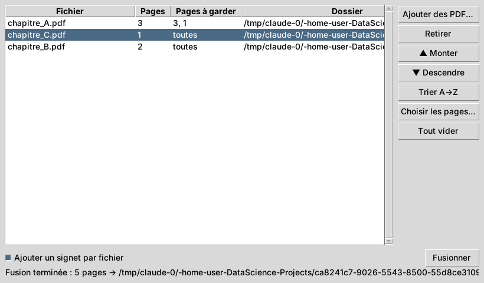

# PDF Merger — rassembler des PDF sous Windows

Petit logiciel gratuit et **100 % hors ligne** (vos fichiers ne quittent pas votre PC)
pour fusionner plusieurs PDF en un seul.



## Fonctionnalités

- Ajouter des PDF par bouton, **glisser-déposer** depuis l'Explorateur, ou un dossier entier
- Réordonner (▲ / ▼, tri A→Z), retirer des fichiers
- Garder seulement certaines pages par fichier : double-clic sur la ligne → `1-3, 5, 8-`
- Un **signet** par fichier source dans le PDF final (désactivable)
- PDF abîmés ignorés avec un avertissement ; PDF protégés par mot de passe signalés
- Ligne de commande pour les scripts

## Installation sous Windows

### Option A — créer un `.exe` (recommandé)

1. Installer [Python 3.10+](https://www.python.org/downloads/windows/) (cocher *Add python.exe to PATH*).
2. Télécharger ce dépôt, ouvrir un terminal dans le dossier `DataScience-Projects`.
3. Lancer :

   ```bat
   pdf_merger\build_exe.bat
   ```

4. L'exécutable est dans `dist\PDFMerger.exe` : double-cliquez dessus, ou glissez des PDF
   directement sur son icône. Vous pouvez le copier où vous voulez (il est autonome).

### Option B — lancer avec Python

```bat
pip install -r pdf_merger\requirements.txt
python -m pdf_merger
```

## Ligne de commande

```bat
python -m pdf_merger a.pdf b.pdf c.pdf -o fusion.pdf
python -m pdf_merger rapport.pdf:1-3 annexe.pdf:5,7- -o extrait.pdf
python -m pdf_merger a.pdf b.pdf -o fusion.pdf --no-bookmarks
```

## Tests

```bash
pytest pdf_merger/tests/ -v
```

## Architecture

```
config.py      ← toutes les constantes et textes de l'interface
page_range.py  ← analyse « 1-3, 5, 8- » → indices de pages
merger.py      ← moteur de fusion (pypdf), sans interface
gui.py         ← fenêtre Tkinter (+ glisser-déposer via tkinterdnd2 si installé)
cli.py         ← point d'entrée : fenêtre par défaut, fusion directe avec -o
launcher.py    ← script d'entrée pour PyInstaller
```

## Logiciels existants similaires

| Logiciel | Type | Remarques |
|---|---|---|
| [PDFsam Basic](https://pdfsam.org) | Windows/Mac/Linux, open source | La référence : fusion, découpe, rotation. Gratuit. |
| [PDF24 Creator](https://tools.pdf24.org/fr/creator) | Windows, gratuit | Très complet, fonctionne hors ligne. |
| [PDF Arranger](https://github.com/pdfarranger/pdfarranger) | Windows/Linux, open source | Réorganisation visuelle des pages par miniatures. |
| [Stirling-PDF](https://github.com/Stirling-Tools/Stirling-PDF) | Web auto-hébergé, open source | Boîte à outils PDF complète dans le navigateur (Docker). |
| [PDFtk](https://www.pdflabs.com/tools/pdftk-the-pdf-toolkit/) / [qpdf](https://github.com/qpdf/qpdf) | Ligne de commande | Pour l'automatisation. |
| iLovePDF, Smallpdf… | En ligne | Pratiques, mais les fichiers sont envoyés sur leurs serveurs. |
